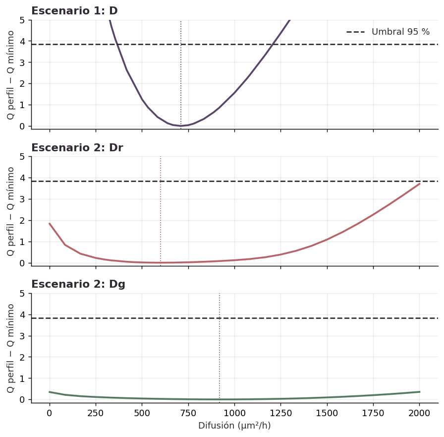

# PINNs e identificabilidad en un modelo de invasión celular

**Un buen ajuste de las densidades celulares no garantiza estimaciones precisas de los parámetros.** Este proyecto estudia esa diferencia mediante inferencia clásica, perfiles de verosimilitud y redes neuronales informadas por la física (PINNs).

Trabajo de **Bamsi Mendez Posada** y **Sergio Alejandro Villada Arias**, Universidad Nacional de Colombia, Sede Manizales. Presentado en el **Segundo Workshop de Estadística**, el **6 de noviembre de 2026**.

**[Póster](docs/Poster_PINNs_FUCCI.pdf) · [Informe técnico](docs/Informe_PINNs_FUCCI.pdf) · [Reproducción](docs/REPRODUCIBILIDAD.md)**

## Pregunta

¿Con qué precisión permiten los datos FUCCI estimar parámetros de invasión celular y cómo cambia su identificabilidad al pasar de una difusión compartida a dos difusiones distintas?

Se usa un sistema de reacción-difusión para dos grupos del ciclo celular: G1 (rojo) y S/G2/M (verde). Los datos contienen 24 posiciones y cuatro tiempos. El estado inicial se fija a partir de t=0; el ajuste emplea **144 densidades** posteriores.

## Resultado principal

| Escenario | Resultado |
|---|---|
| Difusión compartida | MLE de D = 709.85 µm²/h; IC perfilado aproximado del 95 %: [365.07, 1207.68] |
| Dos difusiones | Los perfiles de Dr y Dg no cruzan el umbral dentro de [1, 2000] µm²/h |
| PINN, difusión compartida | Media de D = 700.09; DE entre diez resultados finales = 3.04; dos corridas requirieron reinicio |
| PINN, dos difusiones | Mayor dispersión entre entrenamientos; cuatro de diez vectores quedan fuera de las cotas de difusión del MLE |

La extensión a dos difusiones mejora muy poco el ajuste. La dispersión entre entrenamientos mide **estabilidad computacional**; los perfiles evalúan **incertidumbre estadística** bajo el modelo de observación. No son magnitudes intercambiables.



## Métodos

- Modelo de Simpson et al. (2020), con condiciones de flujo nulo y estado inicial suavizado mediante cosenos.
- Máxima verosimilitud equivalente a mínimos cuadrados con errores gaussianos iid y σ = 0.05 fija.
- Solución por diferencias finitas en 139 nodos y optimización desde varios inicios.
- PINN inversa con condiciones iniciales y de frontera incorporadas en la arquitectura; Adam y L-BFGS.
- Perfiles con reoptimización de los demás parámetros, Fisher, residuos y verificación independiente de parámetros PINN mediante el solver clásico.

## Contenido del repositorio

| Ruta | Contenido |
|---|---|
| `docs/` | Póster, informe PDF y LaTeX, procedencia y reproducción |
| `src/` | Solver, MLE, PINN y controlador de réplicas |
| `notebooks/` | Verificación y perfiles; dos notebooks seleccionados sin salidas guardadas |
| `data/` | Datos reorganizados en CSV y diccionario |
| `results/published/` | Evidencia numérica conservada del trabajo presentado |
| `figures/` | Figuras seleccionadas |
| `scripts/` | Resumen y comprobación de datos y resultados |

## Ejecución rápida

Con Python 3.11 o posterior, desde la raíz:

```bash
python -m pip install -r requirements.txt
python scripts/resumir_resultados.py
python scripts/verificar_proyecto.py
python src/fit_fd.py --scenario 1
```

PyTorch se instala por separado con `requirements-pinn.txt`. Los notebooks recalculan análisis sin entrenar redes. Consulta [REPRODUCIBILIDAD](docs/REPRODUCIBILIDAD.md) para perfiles, entrenamiento, costes y compilación del informe.

## Alcance

Los intervalos son aproximados y condicionales al ruido supuesto, estado inicial, cotas y modelo. No se ha demostrado identificabilidad estructural ni evaluado cobertura por simulación. Las métricas son dentro de muestra. La PINN y el MLE usan restricciones paramétricas diferentes. Se conserva evidencia de las corridas finales, pero no todos sus pesos y registros: no se garantiza una reconstrucción bit a bit.

Este repositorio selecciona la implementación correspondiente a las cifras finales; excluye versiones exploratorias con otras condiciones de modelado. La edición documental no implica que se hayan repetido los veinte entrenamientos originales.

## Autoría y referencias

Proyecto conjunto: componente neuronal y experimentos PINN, Sergio Alejandro Villada Arias; inferencia y análisis estadístico, Bamsi Mendez Posada. Documentación y preparación del repositorio con asistencia de IA. [Procedencia y transformaciones](docs/PROCEDENCIA.md).

- Simpson, Baker, Vittadello y Maclaren (2020). *Practical parameter identifiability for spatio-temporal models of cell invasion*. [Artículo](https://doi.org/10.1098/rsif.2020.0055) · [Material suplementario](https://doi.org/10.6084/m9.figshare.c.4862265.v1).
- Raissi, Perdikaris y Karniadakis (2019). *Physics-informed neural networks*. [DOI](https://doi.org/10.1016/j.jcp.2018.10.045).
- Raue et al. (2009). *Structural and practical identifiability analysis … by exploiting the profile likelihood*. [DOI](https://doi.org/10.1093/bioinformatics/btp358).

Los datos, modelo, artículos y recursos institucionales se atribuyen a sus autores. No se incluyen copias completas de los artículos ni se asigna una licencia global a material de terceros.
